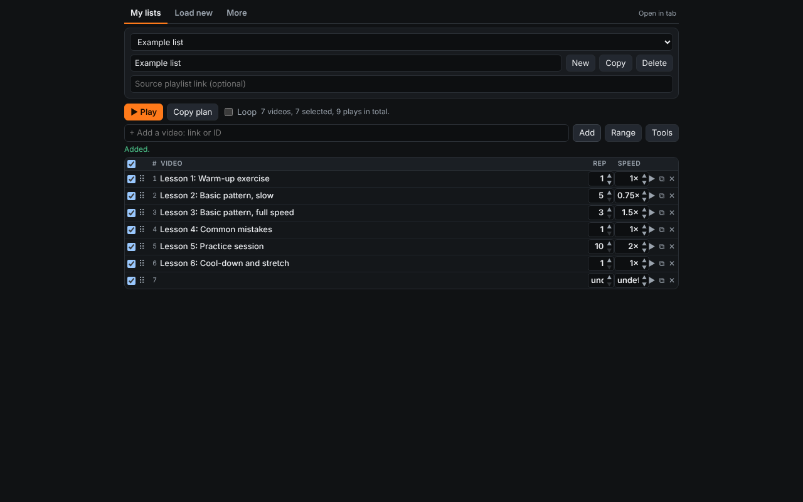
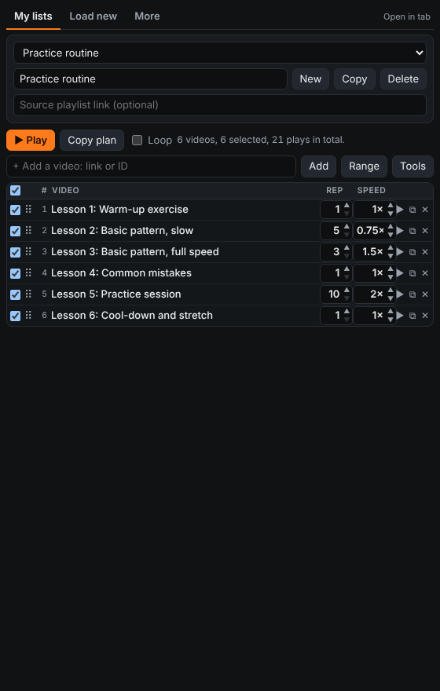
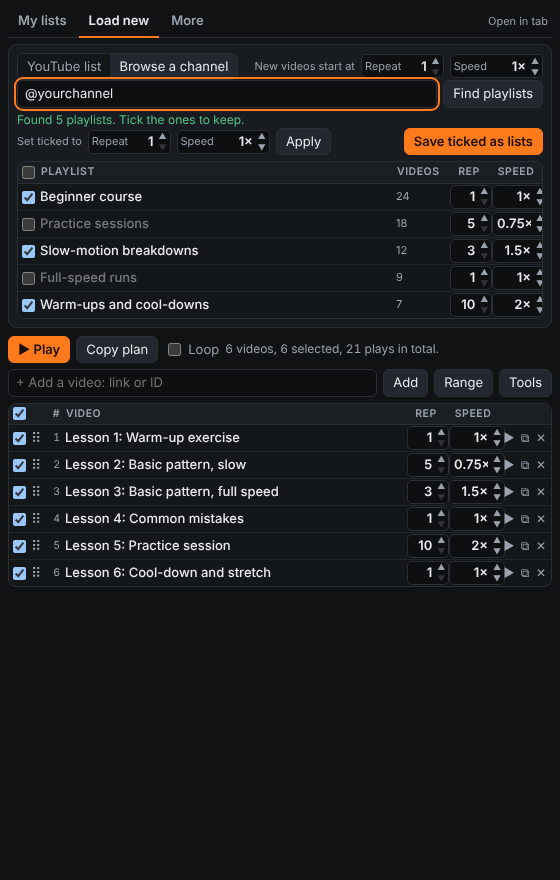
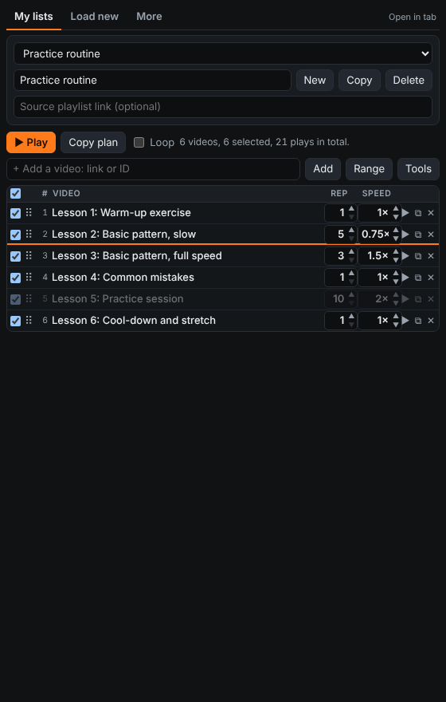
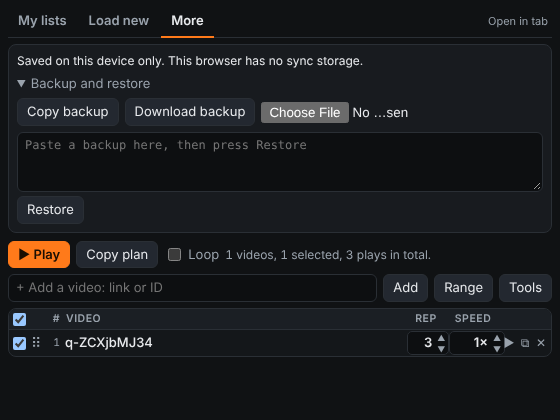

# Repeat Playlist Player

A browser extension for building a daily listening or practice list from YouTube videos: choose the videos, put them in your order, and set **how many times each one repeats** and **at what speed**. It plays on youtube.com in your own signed-in browser, using YouTube's own player, so your Premium speeds (up to 4x) and ad-free playback apply. It never hides, skips or alters ads.

## Features

- **Per-video repeats and speed** (repeats 1 to 999, speed 0.25x to 4x), set with compact steppers or typed in.
- **Optional start and end times** to play only part of a video.
- **Load a public playlist** by link or ID, or **browse a channel** and pick several of its playlists at once.
- **Several saved lists**, each with its own order, repeats, speeds, ranges, ticks and loop setting.
- **Drag and drop** reordering in a compact table (or Alt+Up / Alt+Down on the keyboard).
- **Loop** the whole list, and use the on-page bar (previous, pause, next, stop) while it plays.
- **Sync** between your devices through your browser's own sync storage, plus **backup and restore**.
- No server, no analytics. See the [privacy policy](https://harishhm74.github.io/repeat-playlist-privacy/).

## Screenshots

| My lists | Load new: browse a channel |
|---|---|
|  |  |

| Drag to reorder | More: backup and sync |
|---|---|
|  |  |

Screenshots use sample titles.

## Install

The extension is not in a store yet, so install it from the zip for your browser.

**Chrome and Edge** (version 114 or newer; opens as a side panel)
1. Unzip `repeat-playlist-chrome-edge.zip` to a folder you will keep.
2. Open `chrome://extensions` (Edge: `edge://extensions`) and turn on Developer mode.
3. Click **Load unpacked** and choose the folder. Pin the extension so its icon stays visible.

**Firefox** (128 or newer; opens as a sidebar)
1. Unzip `repeat-playlist-firefox.zip`.
2. Open `about:debugging#/runtime/this-firefox`, click **Load Temporary Add-on**, and choose `manifest.json`.
3. Temporary add-ons are removed when Firefox closes. A permanent install needs a signed build (free self-distribution signing at addons.mozilla.org).

**Safari** (Mac, iPhone, iPad): experimental. Convert with Xcode using `repeat-playlist-safari-SOURCE.zip` and follow `SAFARI_SETUP.txt`. It is untested on real devices; on iPhone, YouTube's mobile player may limit speed and controls.

**Chrome on iPhone/Android** does not support extensions.

## How to use

1. Click the toolbar icon to open the editor. It has three tabs: **My lists**, **Load new** and **More**.
2. **Load new**: choose *YouTube list* and paste a public playlist link, then **Load as new list** (or **Add to current list**). Or choose *Browse a channel*, enter a channel link or `@handle`, press **Find playlists**, tick the playlists you want, set their repeats and speed, and press **Save ticked as lists**. Each becomes its own saved list.
3. **My lists**: pick, rename, copy or delete a saved list. The table below shows the selected list.
4. **Edit the list** in the table:
   - Tick or untick videos (the header checkbox toggles all).
   - Drag the ⠿ handle to reorder.
   - Set **Rep** and **Speed** with the arrows, by holding them, or by typing a value.
   - **Range** shows Start and End columns (seconds or m:ss).
   - ▶ starts the list from that video, ⧉ duplicates a row, ✕ removes it.
   - **Tools** has Reverse, Shuffle, and "set ticked to" for repeats and speed.
   - The box above the table adds a single video by link or ID.
5. Press **▶ Play**. A youtube.com tab opens and plays the ticked videos in order. If it doesn't start, press **Copy plan**, open any YouTube page, click **Plan** in the bar at the bottom left, paste, and press **Start plan**.

## Sync and backup

Lists are saved on the device and mirrored to browser sync storage (keep extension sync on in Chrome, Edge or Firefox). Deleting a list on one device deletes it everywhere. Sync storage is small (about 100 KB); if it fills, the editor shows a warning and lists stay on the device. **More → Backup and restore** copies or downloads a JSON backup you can restore on another browser or device.

## Permissions

| Permission | Why |
|---|---|
| `storage` | Saves your lists and settings locally and in browser sync. |
| `sidePanel` (Chrome, Edge) | Shows the editor in the side panel. |
| Access to `youtube.com` | Controls YouTube's own player so your list plays, and reads public playlist and channel pages when you load a link. |

## Limitations

- Playlist and channel import read YouTube's public pages; if YouTube changes them, import may stop working (adding single videos still works).
- Videos play inside one YouTube page, so the address bar and tab title may not change between videos.
- Speeds above 2x need YouTube Premium and only work in YouTube's own player.
- Drag and drop needs a mouse or trackpad.

## Privacy

Nothing is collected or sent anywhere except to youtube.com. Full text: https://harishhm74.github.io/repeat-playlist-privacy/

## Repository

`index.html` is the privacy policy page (served by GitHub Pages). `images/` holds the screenshots used above.
